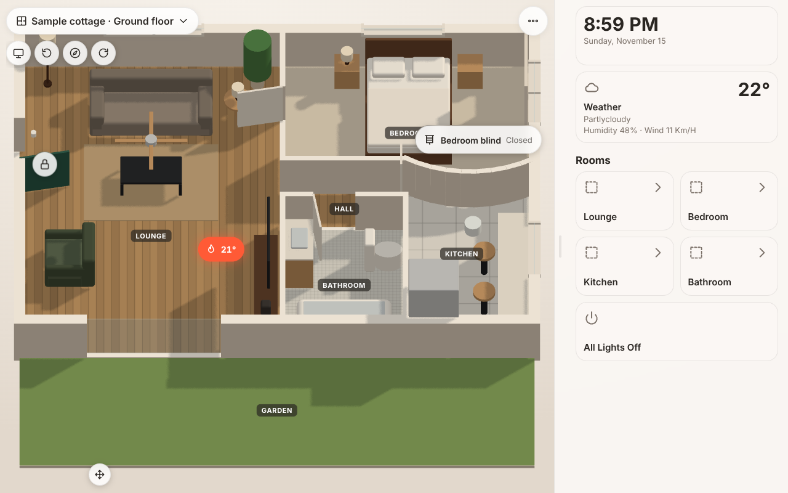

# Nidorama

**Your home, as a floor plan you can touch.** Nidorama is a dashboard for Home Assistant that looks
like your home: draw your rooms, drop in furniture, connect your devices, then tap the lamp to switch
it and swipe to dim it. It runs on your own network: no accounts, no cloud, no tracking.

**Website: [nidorama.io](https://nidorama.io)**

- **Install on Home Assistant:** [add this repository to your Home Assistant](https://my.home-assistant.io/redirect/supervisor_add_addon_repository/?repository_url=https://github.com/Nidorrery/Nidorama), then install Nidorama from the add-on store.
- **Install the Android app:** [download the latest APK](https://github.com/Nidorrery/Nidorama/releases/latest/download/Nidorama.apk) on your phone or tablet and open it.



## Why

Home Assistant lets you make your home do exactly what you want. What's hard is a dashboard that
feels like *your* home: floor-plan dashboards usually take custom cards, several add-ons, image
editing, a lot of YAML and a lot of evenings. Nidorama is a home builder and a dashboard in one, so
anyone can build theirs without any of that.

## What it does

- **A home builder, a bit like The Sims.** Draw walls, doors and windows, paint floors, drop in
  furniture, and connect each thing to its device as you go: the lamp on the plan is your lamp.
- **Everything does what you tell it.** Tap, hold and swipe on any piece of furniture can each do
  something different: tap the lamp to switch it, swipe to dim it, hold for every control.
- **Zoom into rooms.** Double-tap a room and you're in it, with that room's controls beside you.
- **Your whole property.** Several levels, roofs you can lift off, sheds and granny flats, the
  garden and the pool, all in one 3D view.
- **As many dashboards as you like.** A plan for each level, and widget dashboards (weather,
  clocks, thermostats, music, cameras, calendars). The panel beside a plan can also show one of
  your Home Assistant dashboards.
- **Your own buttons, wherever you want them,** on the plan or beside it, including groups that
  fan out more buttons.
- **Shared or private.** Share dashboards with the whole household, or keep some just for you.
- **Made for wall tablets.** Use it as the tablet's home screen or in kiosk mode; the Home
  Assistant app is one tap away.
- **From a rough paper sketch to a plan,** with a step-by-step guide, if drawing isn't your thing.
- **Looks how you like.** Plan styles from illustrated to realistic, and themes with their own
  day and night looks.
- **Everything stays at home.** It talks to Home Assistant on your own network.

It is a young project, tested so far on a handful of homes, so you may well find bugs. Please
report them, and send ideas, in [the request log](https://github.com/Nidorrery/Nidorama/issues) or from inside the app (More → Requests).

## Getting it

**Home Assistant add-on** (Nidorama in your sidebar; every device in the house shares the same
homes): Settings → Add-ons → Add-on store → ⋮ → Repositories, add `https://github.com/Nidorrery/Nidorama`, then install
*Nidorama*. It also answers on port 8765, so wall tablets and browsers can open it directly.

**Android** (phones and wall tablets): download the APK from [the latest release](https://github.com/Nidorrery/Nidorama/releases/latest)
and open it. Then *Create a home*, *Import a home file* or try the sample, and connect Home Assistant
in More → Settings (sign in, or a long-lived access token). On a wall tablet: tick *Offer Nidorama as
a home screen*, then *Change default launcher*, and choose More → *Start this device here* on the
plan or room that tablet should show.

**Any browser:** open the add-on from Home Assistant on any computer, phone or tablet.

Also connects to Homey Pro (local API key). With nothing connected the app shows a simulated home.

## The code

- `src/` — the web app: `scene.js` (three.js renderer and styles), `editor.js` (designer),
  `dashboard.js` (home pages), `store.js` (library, import/export, sync), `ha.js` (Home Assistant).
- `android/` — Capacitor shell for the APK (launcher mode, open-HA-app button, file export).
- `addon/nidorama/` + `Dockerfile.addon` + `repository.yaml` — the Home Assistant add-on.
- `site/` — the website. `docs/home-format.md` — the home file format.

## Developing

```sh
npm install
npm run dev            # http://localhost:5173
npm run android:sync   # build + copy into android/ (then open android/ in Android Studio)
```

## Licence and contributing

Free and open source under the GNU AGPL, version 3: see [`LICENSE`](LICENSE) and [`NOTICE`](NOTICE).
The name and icon are covered separately: see [`TRADEMARKS.md`](TRADEMARKS.md).
Ideas, bug reports and code are welcome: see [`CONTRIBUTING.md`](CONTRIBUTING.md).
